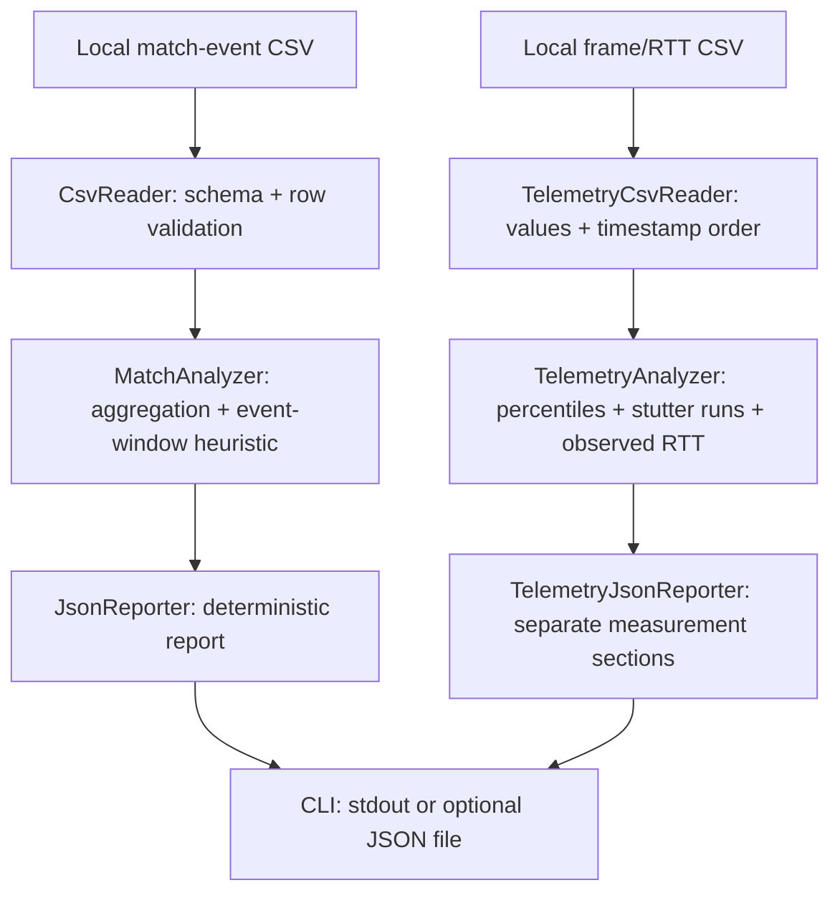

# RiftPulse — Engineering case study

**Project:** C++20 offline telemetry analyzer · **Modes:** match events and frame-time/round-trip timing  
[Project overview](../README.md) · [Technical measurement definitions](performance-telemetry.md) · [Validation matrix](../evidence/validation-matrix.md)

## Problem and scope

Performance complaints are often described as "lag," even though slow frames and network request/response delays are different measurements. A useful diagnostic tool should report what a dataset actually contains, keep missing observations separate from zero values, and provide repeatable results without attributing causes the measurements cannot establish.

RiftPulse implements two independent CSV-to-JSON workflows for fictional, locally supplied data. The **match-event** workflow validates records, groups player activity, and identifies dense event windows for review. The **performance telemetry** workflow measures frame-time distributions and groups slow frames, while summarizing observed round-trip times in a separate section.

RiftPulse is an independent educational project; it does not instrument, access, or optimize a Riot Games product.

## Architecture



| Component | Responsibility |
| --- | --- |
| [`src/csv_reader.cpp`](../src/csv_reader.cpp) | Match-event schema, CSV quotes, type/value validation and row warnings |
| [`src/analyzer.cpp`](../src/analyzer.cpp) | Player aggregation, sorted output, gold-per-minute and burst-window signals |
| [`src/telemetry.cpp`](../src/telemetry.cpp) | Frame/RTT input validation, nearest-rank percentiles, stutter grouping, JSON |
| [`src/json_reporter.cpp`](../src/json_reporter.cpp) | Deterministic JSON escaping and match reporting |
| [`src/main.cpp`](../src/main.cpp) | CLI mode selection, process exit codes, file handling |

The CLI uses a C++20 library target, `riftpulse_lib`, keeping parsers and analyzers independently unit testable.

## Key decisions

### Separate frame time from round-trip timing

A slow frame could reflect CPU, GPU, drivers, rendering, or scheduling; a measured request/response duration is also not a proof of its cause. The JSON stores `frame_time` and `round_trip_latency` in **separate groups**. Blank RTT fields are excluded instead of counted as zero, and no causal relationship is inferred.

### Reproducible statistics and explicit definitions

- `mean_fps = 1000 / mean(frame_time_ms)`, not the mean of instantaneous FPS values.
- p95 and p99 use **nearest-rank percentiles** on sorted observations.
- The approximate 1% low is `1000 / mean(slowest max(1, ceil(1% of frames)) frame durations)`.
- A stutter event is a contiguous sequence of accepted frames with `frame_time_ms >= threshold`.
- Frame timestamps must increase strictly. Durations must be positive and finite; optional RTT values must be finite and non-negative.

These conventions, including the inclusive 33.3 ms sample threshold, are documented in [performance telemetry notes](performance-telemetry.md).

### Fail visibly on malformed data

The CSV readers report skipped invalid rows with warnings and an `invalid_rows` counter. The CLI uses distinct exit codes for usage errors, analysis/I/O errors, and partially rejected input. A focused safety check rejects `--output` paths that refer to the **same existing file** as the input CSV so a generated report cannot replace its own source. Distinct destination paths are not staged atomically.

### Review signal, not accusation

Match-event bursts are heuristic signals identifying dense windows for **human review**. They are not a cheating or misconduct determination. Input matches must be consistent, and the output lists players in deterministic order.

## Reproducing the evidence

Run the sample match workflow:

```bash
riftpulse --input data/match_events.csv
```

Run frame-time analysis with a synthetic 33.3 ms threshold:

```bash
riftpulse --telemetry data/performance_samples.csv --stutter-ms 33.3
```

Here `riftpulse` means the compiled executable; on Linux a CMake build typically produces `./build/riftpulse`, and on Windows Visual Studio Release builds typically use `.\\build\\Release\\riftpulse.exe`.

The [match JSON](../evidence/sample-report.json) contains a 1,800-second sample match, two player summaries and no rejected rows. The [telemetry JSON](../evidence/telemetry-sample-report.json) contains **25 frame samples**, p95/p99 frame durations of **49/70 ms**, **three stutter frames grouped into two events**, and **21 observed RTT entries**. These are **synthetic fixture results**, not measured game FPS, network latency or hardware performance.

## Validation and test strategy

- The existing **12 C++ test functions** span two CTest executables, covering quoted and invalid CSV rows, aggregation, JSON escaping, mixed match rejection, telemetry schema/ordering, percentile definitions, stutter grouping, missing RTT, invalid settings, and timing primitives.
- The new **11 Python standard-library CLI tests** exercise both end-to-end workflows, compare parsed JSON with committed fixtures, check output-file behavior, verify exit codes for malformed inputs, and ensure identical input/output paths are rejected without changing the source file.
- The CMake/CTest project registers **3 checks**: the two C++ executables and the CLI integration suite.
- GitHub Actions builds and runs the same tests on **Windows and Ubuntu**. Results for the exact source commit are recorded in the [validation matrix](../evidence/validation-matrix.md); don't infer that a job passed solely from workflow configuration.

## Preliminary Windows benchmark (historical)

The checked-in [benchmark CSV](../evidence/benchmark-results.csv) describes five Windows 10 MSVC Release runs on each of two synthetic match-event datasets. Reported median end-to-end durations were **21.98 ms at 10,000 events** and **132.96 ms at 100,000 events**. Each observation includes process startup, input reading, match analysis and JSON reporting; measurements predate the frame-time extension and are not comparative algorithm or gaming FPS benchmarks. The slow first 10,000-event run (**85.72 ms**) was retained instead of excluded.

Without machine specifications, a controlled warm-up policy, and additional repetitions, these figures support only a preliminary local observation, not performance guarantees.

## Tradeoffs and limitations

- **CSV scope:** match-event records are line-oriented; quoted values cannot span physical lines. One match is expected per analysis.
- **Memory:** events are retained in memory, and per-player timestamps are sorted to examine burst windows; very large datasets would benefit from streaming and bounded-memory design.
- **Input semantics:** frame timestamp/capture placement changes interpretation. Missing/invalid samples can affect contiguous stutter grouping.
- **No causality:** frame-time percentiles do not distinguish CPU, GPU, display, or network causes; application RTT is not automatically game-server ping.
- **No live integration:** there is no game client hooking, proprietary API integration, packet capture, overlay or real-player profiling.
- **Safety:** rejecting identical input/output files avoids one overwrite hazard but does not make all report writing crash-safe, concurrent-writer-safe, or atomic.

## Interview-ready explanation

> RiftPulse is my C++20 offline analysis tool for two kinds of structured data: match events and frame/round-trip timing samples. I separated parsing, analysis and reporting so I could validate each independently. I chose explicit percentile and stutter definitions, and I kept missing round-trip values distinct from zero because treating missing values as measured zero would distort statistics. I added end-to-end CLI tests that reproduce the checked-in JSON and check error handling, then validated the build on cross-platform CI. The sample data are fictional; these results demonstrate correct analysis of the fixtures, not a diagnosis of a commercial game's performance.
